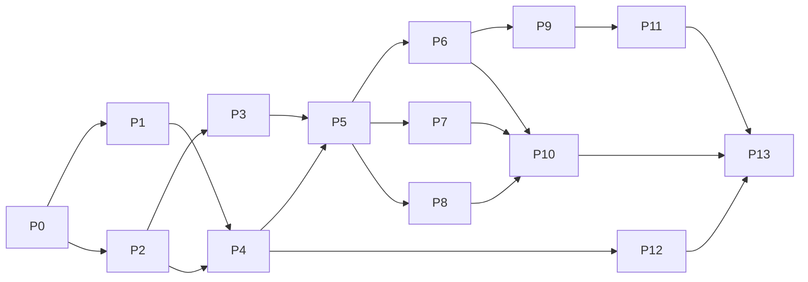

# StudyAir - Plan

## Product Brief v2 (2026-10-29)

StudyAir is a **task schedule maker** for Indonesian middle and high school students. Students enter tasks with a deadline and an estimated study time. The app builds a plan of study blocks in the free time around classes. The school timetable is an INPUT, not the main feature.

**Success test**: a student can add a task in under 10 seconds, tap "Buat jadwal", and when opening the app knows what to do now within 3 seconds.

### Core Loop
```
Tambah tugas (with estimate)
  → Buat jadwal
  → Preview and accept
  → Follow "Rencana hari ini"
  → Mark done
  → Missed blocks are rescheduled
```

AI suggests (duration estimates, reading text and photos), code decides (the scheduler is deterministic and fully tested). Nothing from AI is saved without confirmation.

### Screens & Minimal UI

**Tabs**: Rencana | Tugas | Kalender, with a center "+" (Tugas baru, Dari foto, Dari teks).

**Header**: streak chip + settings icon. **Pengaturan**: Jadwal sekolah, Mapel, Waktu belajar, Pengingat, Streak, Data & Cadangan, Lanjutan.

1. **Rencana (home)**: header → NEXT block as one large card with "Mulai fokus" → today's remaining blocks → "Besok" collapsed to one line. If tasks are unscheduled: one banner with "Buat jadwal" button. Nothing else above the fold.
2. **Tugas**: grouped Terjadwal / Belum dijadwalkan / Tidak muat / Selesai. Each row: subject dot, title, deadline, next block time. "Buat jadwal" button when needed.
3. **Kalender**: Agenda by default (classes, blocks, deadlines, exams). Garis waktu and Bulan as secondary views. Blocks are dashed outlines; classes are solid.
4. **Sheets**: same BottomSheet component, required fields first, optional under "Opsi lainnya".

**Hidden or Moved**: Copilot (flag off), heatmap, cognitive-load chart, SM-2 UI, storage/backup card (→ Pengaturan), bag/uniform checklist (one row inside Besok), exam countdown (one line + "Buat rencana belajar"), Pelajaran tab (→ Pengaturan > Jadwal sekolah).

### Tidy Rules (every packet)
- One primary action per screen. Max 2 icon actions in a header. Max 3 sections above the fold.
- One level of detail by default; everything else into an expandable row or sheet.
- Cards only for tappable things. Subject color as 4dp stripe or dot. One accent color (blue); amber/red/green for status; purple for AI.
- 4 text sizes, 3 spacing steps (8, 16, 24), 16dp screen padding, one shared component per job.
- No duplicated information or actions on a screen. All text Indonesian from `i18n.ts`; local date formats; no ISO dates.

### Not Now
Cloud sync, social features, new analytics, Copilot chat, share-timetable (revisit after pilot).

---

## Working Rules
1. **Work phase by phase**: Complete each phase thoroughly before moving forward.
2. **Phase completion protocol**: After each phase, summarize changes, execute all automated tests, provide a manual phone checklist, and stop to await explicit confirmation.
3. **Do not break working features**: Preserve existing functionality, backwards-compatible models, and established UX patterns.
4. **AI extracts, code decides**: All dates, calendar midnights, deadline calculations, and "next class" intervals are deterministically calculated by code. AI output is strictly treated as suggestions and requires user confirmation before saving to storage.
5. **No personal data or secrets**: Never write API keys, access tokens, or student/teacher personal information into any notes or committed files.

---

## Legacy Phase Status (v1 — superseded by v2 roadmap)

> These phases built the codebase that v2 builds on. They are complete and not re-executed. Kept for historical reference.

| Phase | Name | Status |
| :--- | :--- | :--- |
| 0 | Audit | `done` |
| 1 | Fixes and simplification | `done` |
| 2 | Data foundation | `done` |
| 3 | Navigation and design system | `done` |
| 4 | AI foundation | `done` |
| 5 | Timetable import & repair | `done` |
| 6 | Today with Tomorrow dropdowns | `done` |
| 7 | Tasks (given date & deadline, AI capture) | `done` |
| 8 | Days off and one-time changes | `done` |
| 9 | Reminders and Settings | `done` |
| 10 | AI quality pass | `done` |
| 11 | V1.1 extras | `done` |
| 12 | Onboarding, polish, release | `superseded` |
| - | UI Fix Pass 1 | `done` |
| - | UI Fix Pass 2 | `done` |
| - | Timetable display bug fix | `done` |
| - | UI Tidy Pass | `done` |
| - | Next Exam Fix | `done` |
| - | Kalender Redesign | `done` |
| - | Study Streak | `done` |
| - | Duolingo-style UI Polish | `done` |
| - | Garis Waktu Timeline Fix | `done` |
| - | Multi-Theme Engine (7 Themes) | `done` |
| - | Preparation Feature Redesign & Editing | `done` |
| - | Duolingo-Calibrated Streak Screen | `done` |
| - | Error 19, Themes Proxy & Task Focus | `done` |
| - | Subject Tab Removal & Task Scheduler Focus | `done` |
| - | App Audit Polish & Task Scheduler Finalization | `done` |
| - | O3 Space UI Redesign & Clean Navigation | `done` |
| - | Remastered Tugas & PR Hari Ini (Gamified Progress & 1-Tap Focus) | `done` |
| - | Transformed "Subjects" into "Next Exams/Ulangan Selanjutnya" | `done` |
| - | Whole-App Remaster (O3 Space Ergonomics & Zen Focus Loop) | `done` |
| - | Duolingo Streak Remaster (Animated Flame, 7-Day Chain, Freeze Slots & Confetti) | `done` |
| - | Streak Update: Sound FX, Tier Variations & Secret Milestones | `done` |
| - | Streak Mascot Evolution: 4-Stage Growing Dragon Companion & Procedural Animations | `done` |
| - | School Planner Transformation: Grades & GPA Tracker, Timetable Tab, Teacher Directory, 5-Tab Bar | `done` |
| - | Standar Nilai Rapor Indonesia & Kalkulator TKA (Kurikulum Merdeka, SNBP & UTBK) | `done` |
| - | Calm Streak Pet Animation & Hide Pet Before Streak Accomplished | `done` |
| - | 9:16 Vertical App Trailer (`1080×1920` Interactive Web + Rendered `.mp4` / `.webm`) | `done` |
| - | Interactive Streak Dragon Companion Care, Custom Naming, XP/Bara Api Feeding & 5 Elemental Skins | `done` |
| - | Mobile-Accessible Contribution Heatmap (Range Zoom, Tappable Cells, Day Inspector & Level Filter) | `done` |
| - | StudyAir v2.0.0 Release & Download Hub (In-App APK Updater, Web Download Portal & Version Bump) | `done` |
| - | Organic Biomechanical Streak Dragon Companion (Circadian Rhythm, 2-Joint Wings, 3-Joint Tail & Care Audio) | `done` |
| - | Navigation History Stack (`BackHandler` + Web `popstate`), v2 Onboarding Modernization & UI Border Harmonization | `done` |
| - | Streak Pet Improvement: Removed Redundant EXP/Level Layer in Favor of Streak Evolution & Daily Satiety (`Kenyang 0/3`) | `done` |
| - | Simplified Stage 4 (`deity`) Streak Dragon Silhouette & Streamlined `StreakScreen` UI | `done` |
| - | "Tinjau Tugas" AI Review UI Overhaul, Smart Compound Splitting, Localization & `DeadlinePickerStrip` Integration | `done` |

### Superseded Packets (v1)

| Packet | Goal | Status |
| :--- | :--- | :--- |
| T-001 | Remove debug console.log | `superseded` — folded into P0 |
| T-002 | Onboarding polish | `done` — rebuilt for v2 loop (`OnboardingModal.tsx`) |
| T-003 | Split CalendarScreen | `superseded` — CalendarScreen rebuilt in P8 |

---

## v2 Roadmap — Task Packet Plan

Packets are ordered by dependency. Each packet is in `docs/tasks/P##-name.md`.

| Packet | Goal | Depends On | Status |
| :--- | :--- | :--- | :--- |
| **P0** | Safety net: backup branch, run all baseline tests, write characterization tests for core logic, clean debug logs | none | `done` |
| **P1** | Design foundation: audit shared components against tidy rules, add missing tokens, ensure 12 common components are correct | P0 | `done` |
| **P2** | Data model: add `estimatedMinutes` to Task, define `StudyBlock` / `BusyBlock` / `SchedulePrefs`, write migrations | P0 | `done` |
| **P3** | Scheduling engine: pure-function `buildSchedule()` with unit tests, property tests, and a debug simulation screen | P2 | `done` |
| **P4** | Add-task flow with time estimates, subject, and deadline — under 10 seconds | P1, P2 | `done` |
| **P5** | "Buat jadwal" flow: options sheet, preview, diff, edit, apply, undo | P3, P4 | `done` |
| **P6** | Rencana screen: NEXT block card + today's blocks + Besok + unscheduled banner | P5 | `done` |
| **P7** | Tugas screen: 4 groups (Terjadwal / Belum dijadwalkan / Tidak muat / Selesai) | P5 | `done` |
| **P8** | Kalender with blocks: Agenda (dashed outlines for blocks, solid for classes), Garis waktu, Bulan | P5 | `done` |
| **P9** | Execution loop: focus timer tied to blocks, missed-block rescheduling, notifications | P6 | `done` |
| **P10** | Navigation restructure: 3 tabs (Rencana, Tugas, Kalender) + center "+", Pengaturan regrouping, hide/move list | P6, P7, P8 | `done` |
| **P11** | Streak (counts finished blocks) and "Buat rencana belajar" from exams | P9 | `done` |
| **P12** | AI helpers: duration estimate, text/photo capture, review screen | P4 | `done` |
| **P13** | Cleanup, QA on real phones, pilot with 5-10 students | all | `done` |



## Status
All 14 task packets (P0 through P13) completed and verified with 100% passing automated test suites, clean TypeScript check, and strict adherence to tidy rules and architecture. Official v2.0.0 release packages the authentic standalone Android APK (`StudyAir-v2.0.0.apk`, 86.2 MB, `versionCode: 2`) built via EAS (`4a39dc68-9a26-4735-aaff-aeffd687dbda`) with the StudyAir calendar + paper plane app launcher icon verified inside the APK (`mipmap-*`), alongside multi-screen distribution across web and mobile and the local APK download portal. Latest UI evaluation pass (2026-11-10) resolved Bugs #23 and #24, unified main-tab headers, simplified `DeadlinePickerStrip`, and decluttered `TasksScreen`, `TimetableScreen`, `StatsScreen`, and `StreakScreen`. 2026-11-15: Completely hid debug menu by default across the app and implemented Android-style 7-tap build number Easter egg to unlock Developer Mode and streak simulator tooling. 2026-11-16: Upgraded Streak Freezing system with automated 3-day consecutive milestone awards, daily completion lucky drop chance (35%), auto-protection on missed school days, proactive freezing, and remastered day medallions (solid bright orange flame circle for completed days, solid bright ice-blue freeze crystal circle for frozen days). Enhanced universal click audio engine with dual-layered low-latency Web Audio API synthesis and removed the "Akhir Pekan" feature to rely on active streak freezing. 2026-11-17: Fixed bell schedule period synchronization between Settings and Timetable Wizard ("Susun Manual"), resolved wizard "Batal" navigation button across web and native platforms, integrated direct "Jam Pelajaran" bell times configuration and modal access on the Jadwal tab (`TimetableScreen`), added dynamic day-specific period resolution, inline "+ Tambah Jam Pelajaran" support, and enabled overdue task rescheduling via `allowOverdue: true` in `schedulerEngine.ts`. All 16 regression test suites and 41 unit tests passing cleanly. 2026-11-18: Successfully launched public web deployment on Vercel Free Hobby Tier (`https://studyair.vercel.app`) with continuous deployment linked to GitHub repo `mahsymahsy6-creator/StudyAir`. Standardized v2.0.1 (Build 4) distribution across web and mobile with high-bandwidth standalone APK downloads powered by GitHub Releases (`StudyAir-v2.0.1.apk`, 86.2 MB) and universal QR code sharing. Delivered the authentic full-featured StudyAir web application to the web platform at `/app` with an interactive live smartphone preview and remastered Indonesian showcase hub at `/`. 2026-11-19: Executed complete web redesign across all pages (Obsidian Slate & Electric Sky aesthetic): asymmetric Hero with interactive smartphone preview stage, problem-versus-solution comparison, 4 Pillars showcase, student personas, interactive FAQ accordion, universal 4-column footer, platform-aware download hub with QR code and visual install guide, adaptive desktop shell container for `/app` with 1-click fullscreen toggle, and legacy route harmonization. Production build passing cleanly with 100% test coverage.


